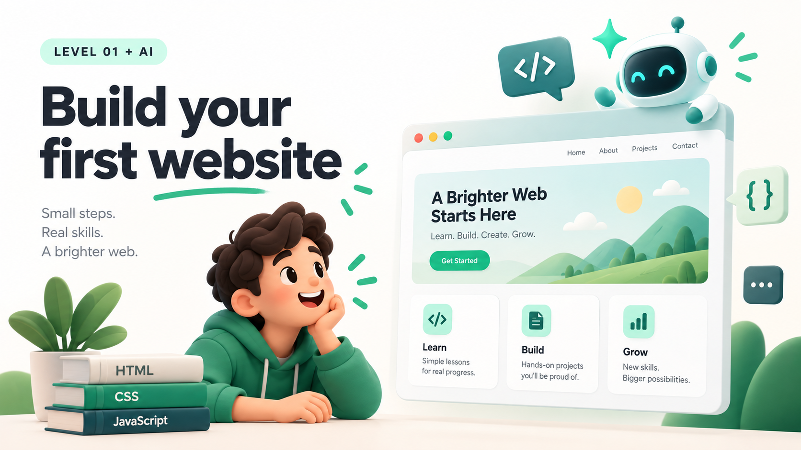

# Website development • Level 1 + AI

Build a small website. Understand the code. Use AI as a helper, not a substitute for checking your work.

## Who this is for

Complete beginners who want to make their first website with HTML, CSS, and JavaScript. No framework, account, paid AI subscription, or build tools are needed for the starter project. This is a foundation, not a complete web development course.

## What you will build

A responsive learning page with a heading, three topic cards, and a button that updates a progress message. It runs locally in your browser. There is no backend, account system, database, or real AI integration in this project. The AI guidance below explains how to use an assistant while you build.

## Start here

1. Download this repository and extract it if needed.
2. Open the folder in a code editor of your choice.
3. Open `index.html` in a browser. Keep `styles.css` and `script.js` in the same folder.
4. Edit a file, save it, and refresh the browser to see the result.

```text
website-development-level-1/
├── README.md
├── index.html
├── styles.css
├── script.js
└── assets/
    └── hero.png
```

## The three building blocks

### 1. HTML: structure and meaning

HTML describes the page's content: headings, paragraphs, links, and buttons. Use meaningful elements instead of making everything a generic box.

```html
<h1>My first website</h1>
<p>One small step, one working page.</p>
<button type="button">Mark a step complete</button>
```

Try it: change the heading in `index.html`. Use one clear main heading for this page, and keep the topic headings below it.

### 2. CSS: layout and appearance

CSS controls the presentation: colors, spacing, typography, and layout. A responsive layout adapts to the space available.

```css
.cards {
  display: grid;
  gap: 1rem;
  grid-template-columns: repeat(auto-fit, minmax(min(100%, 14rem), 1fr));
}
```

Try it: change the accent color in `styles.css`, then resize the browser. The cards should fit on a narrow screen without making the whole page scroll sideways.

### 3. JavaScript: behavior

JavaScript can respond to events and update the page. The starter listens for a button click and changes a progress message.

```javascript
const button = document.querySelector("#complete-step");
const message = document.querySelector("#progress");

button.addEventListener("click", () => {
  message.textContent = "First step complete. Keep building!";
});
```

Try it: change the message. The progress resets when the page reloads because the starter does not save it.

## How to build with AI

An AI assistant can help explain code, propose a small draft, suggest tests, or investigate an error. Its output can be wrong, outdated, inaccessible, or unsafe. You remain responsible for what you publish.

### Step 1. Define a small result

Decide what the page is for, who will use it, and what it must do. Start with one page and one interaction, rather than asking for an entire product.

**Prompt to try**

> Help me plan a beginner learning website. Use plain HTML, CSS, and JavaScript, with no libraries or backend. It needs a heading, three topic cards, and one progress button. First give me a short plan and explain the three files. Do not generate code yet.

### Step 2. Ask for one change at a time

Give the assistant only the relevant code and a clear constraint. Smaller changes are easier to understand and undo.

**Prompt to try**

> Here is my HTML. Suggest only the CSS needed to make these cards responsive. Keep the HTML unchanged. Explain each new rule in beginner-friendly language, and tell me how to test it on a narrow screen.

### Step 3. Ask for explanations before accepting code

Read the change and compare it with the original. If you cannot explain what it does, ask for a smaller example.

**Prompt to try**

> Explain this JavaScript line by line. What happens when the button is clicked? What happens after a page refresh? Give me one small exercise without writing its solution.

### Step 4. Debug with evidence

Describe the expected result, what actually happened, and the exact error message. Share the smallest code example that reproduces the problem. Remove private data first.

**Prompt to try**

> Expected: the progress message changes when I click the button. Actual: nothing changes. Here are the button HTML, the script tag, and my JavaScript. Help me find the cause. Explain the smallest fix rather than rewriting the whole page.

### Step 5. Test the result yourself

AI suggestions are not proof that a site works. Open the page, try the interaction, use the keyboard, inspect the browser console, and check a narrow and wide screen. Keep a working copy before changing it, or use small Git commits.

**Prompt to try**

> Review this page for possible accessibility and mobile layout problems. Separate confirmed issues from things I need to test in a browser. Do not claim you ran tests unless you actually did.

## Safety habits from day one

- Never paste passwords, API keys, customer data, or private documents into an AI prompt or public repository.
- Do not put secret API keys in frontend JavaScript. Visitors can inspect the code delivered to their browser.
- Review new dependencies and external scripts before adding them. The starter needs none.
- Use `textContent` when inserting plain text. Do not insert untrusted input as HTML.
- Use images and text you have permission to publish. Check licenses before copying code or assets.
- A working demo is not a production security review. Authentication, payments, and personal data need more care than this starter covers.

## Test checklist

- [ ] Open `index.html` and confirm the styling loads.
- [ ] Click "Mark a step complete" and check that the progress message changes.
- [ ] Reload and confirm the message resets. This is expected.
- [ ] Use Tab to focus the button, then activate it with Enter or Space.
- [ ] Check the layout at narrow and wide widths, and with browser zoom.
- [ ] Check the browser console for errors.
- [ ] Confirm your public files contain no private information or secrets.

## Small challenges

1. Replace the example heading and introduction with your own fictional project idea.
2. Add a fourth topic card using the same HTML structure.
3. Add a reset button and explain its event listener.
4. Ask AI to suggest a change, then write down what you checked before accepting it.

## Before publishing

Creating a public GitHub repository shares the source files. It does not automatically make a live website. Deploying a website is a separate step. Review the content and files first; do not include real contact details unless you intend to share them publicly.

## Ready for Level 2?

Move on when you can explain what each file does, make a small change yourself, debug a broken file path, and test an AI suggestion instead of trusting it blindly. Next topics: forms, DOM manipulation, Git, deployment, and basic accessibility.

## References

- [MDN: Your first website](https://developer.mozilla.org/en-US/docs/Learn_web_development/Getting_started/Your_first_website)
- [MDN: CSS and styling](https://developer.mozilla.org/en-US/docs/Learn_web_development/Getting_started/Your_first_website/Styling_the_content)
- [MDN: JavaScript and interactivity](https://developer.mozilla.org/en-US/docs/Learn_web_development/Getting_started/Your_first_website/Adding_interactivity)

The banner is an AI-generated conceptual illustration. The starter and prompts are educational examples, not an endorsement of a particular AI service.
